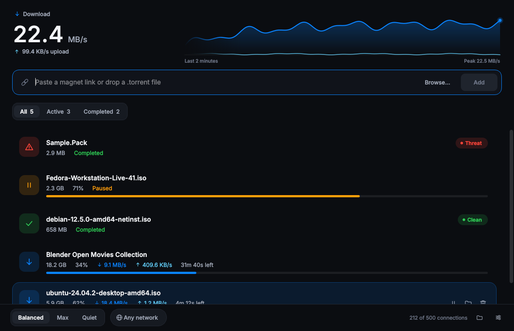
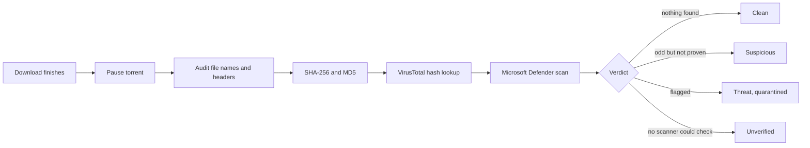
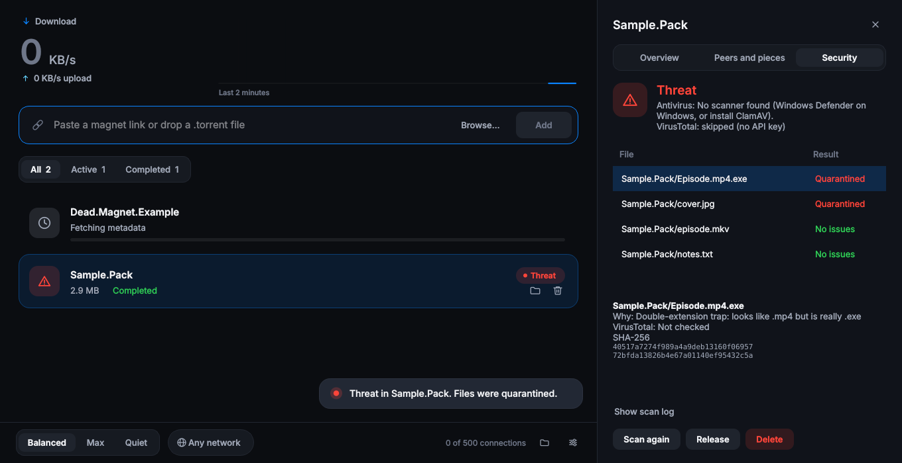

<div align="center">


# ApexTorrent

**A fast, free, ad-free BitTorrent client for Windows that scans every finished download before you open it.**

[](https://github.com/KhanAdeeb1/Apex_Torrent/actions/workflows/build-windows.yml)
[](https://github.com/KhanAdeeb1/Apex_Torrent/releases/latest)


[](LICENSE.txt)

[**⬇️ Download**](https://github.com/KhanAdeeb1/Apex_Torrent/releases/latest) ·
[Features](#features) ·
[Security scan](#security-scan) ·
[FAQ](#faq) ·
[Build from source](#build-from-source)

<br>



<sub>Sample data, to show the layout. The header is live: current speed and a two-minute throughput graph.</sub>

</div>

---

## ✨ Why ApexTorrent

Most torrent clients are either full of ads and bundled offers, or bare-bones with no protection. ApexTorrent is neither.

| | |
|---|---|
| 🚫 **No ads, no bundles, no tracking** | Nothing is installed besides the app. No toolbars, no offers, no telemetry. |
| ⚡ **No speed cap** | The app never limits your bandwidth. Your speed depends on seeders, your ISP and your router. |
| 🌙 **Built for dark mode** | A quiet, modern interface with one live graph and nothing you do not need. |
| 🛡️ **Scans before you open anything** | Every finished download is paused, audited, hashed and checked before it is declared safe. |
| 🔒 **VPN kill switch** | Bind all traffic to one network adapter. If it drops, everything pauses instead of leaking. |
| 💸 **Free and open source** | MIT licensed. Read the code, build it yourself. |

<a id="features"></a>
## 🚀 Features

<table>
<tr>
<td width="50%" valign="top">

### ⬇️ Downloading
- 🧲 Magnet links and `.torrent` files
- 🖱️ Click a magnet link in your browser and it opens in ApexTorrent
- 📂 Drop a `.torrent` anywhere on the window, or paste a link into the bar
- 📋 Press **Ctrl+V** with a magnet link on your clipboard and it is added
- 💾 Saves to one folder you choose
- ♻️ Resumes where it left off after a restart
- 1️⃣ One window: opening a second link hands it to the running app

</td>
<td width="50%" valign="top">

### 🚦 Speed tuning
- 🎚️ Three presets: **Balanced**, **Max**, **Quiet**
- 🤖 Adaptive tuning raises connection limits when your link is saturated, and backs off when throughput drops
- 🔐 Optional required encryption
- 🧪 The Overview tab explains why a torrent is slow (no peers, tracker errors, and so on)
- 📈 A live two-minute graph of download and upload speed in the header

</td>
</tr>
<tr>
<td width="50%" valign="top">

### 🛡️ Security
- 🔍 Detects double-extension traps like `movie.mp4.exe`
- 🎭 Detects executables disguised as images, video or documents
- 🧬 SHA-256 and MD5 fingerprints of every file
- 🌐 VirusTotal hash lookup (hash only, your files are never uploaded)
- 🦠 Microsoft Defender scan of the download
- 🗃️ Automatic quarantine, with release and delete buttons

</td>
<td width="50%" valign="top">

### 🔎 Inspector
- 📊 Overview with health checks and tracker status
- 🧩 Live piece map and peer list
- 📋 Per-file scan results, with the reason and SHA-256 for each file
- 📝 Full scan log you can open

</td>
</tr>
</table>

<a id="security-scan"></a>
## 🛡️ How the security scan works

When a torrent finishes, ApexTorrent pauses it first so nothing keeps seeding unchecked, then runs this pipeline:



| Verdict | Meaning |
|---|---|
| ✅ **Clean** | A scanner or VirusTotal actually checked the files and found nothing. |
| ⚠️ **Suspicious** | Something looks off (hidden scripts, shortcuts, odd names) but nothing is proven. |
| ⛔ **Threat flagged** | A rule or scanner flagged the file. It is renamed to `*.quarantined` and its execute permission is removed. |
| ❔ **Unverified** | No scanner was available, so ApexTorrent does not call it clean. |

**What the audit looks for:** double extensions (`.mp4.exe`), executables hiding under media or document names, hidden scripts, shortcut files, right-to-left override characters in names, and zero-byte media files.

**VirusTotal** needs a free API key (Settings → VirusTotal API key). Only hashes are sent. To respect the free quota it checks at most 10 files per torrent, 16 seconds apart, and only executables, scripts, archives and already-flagged files.

<div align="center">

<br><sub>The Security tab on a test download containing a fake <code>Episode.mp4.exe</code> and an executable disguised as <code>cover.jpg</code>. Both were quarantined.</sub>
</div>

> [!IMPORTANT]
> A scan lowers risk, it does not remove it. Signature scanners miss new malware. Never run an executable from a source you do not trust, whatever the result says.

## 📦 Install

1. Go to the [**latest release**](https://github.com/KhanAdeeb1/Apex_Torrent/releases/latest) and download `ApexTorrent_Setup.exe`.
2. Run it. Windows may show **"Windows protected your PC"** because the installer is not code-signed. Click **More info → Run anyway**. (See the [FAQ](#faq).)
3. Choose your options on the Tasks page: desktop shortcut, start with Windows, `.torrent` and `magnet:` associations, firewall rule.
4. Launch ApexTorrent.

Requires **Windows 10 or 11, 64-bit**. No Python needed.

The installer can also set up a Windows Firewall rule so incoming peers can reach you, which helps speed. It needs administrator rights; a per-user install without admin works too, just without that rule.

## 🧭 Quick start

1. Paste a magnet link into the bar and press **Enter**, or drop a `.torrent` onto the window.
2. Pick a **preset** at the bottom left.
3. Optional: click **Any network** next to it and pick your VPN adapter to turn on the kill switch.
4. Double-click a torrent to open the inspector: health, peers, pieces and the security report.
5. Click the sliders button at the bottom right (or press **Ctrl+,**) for settings, including the download folder.

| Shortcut | Action |
|---|---|
| **Ctrl+V** | Add a magnet link from the clipboard |
| **Space** | Pause or resume the selected torrent |
| **Delete** | Remove the selected torrent from the list (files are kept) |
| **Esc** | Close the inspector |
| **Ctrl+,** | Open settings |

Hover a torrent to pause it, show it in its folder or remove it. Right-click for the same actions plus Inspect.

### Presets

| Preset | Connections | Notes |
|---|---|---|
| ⚖️ **Balanced** | 500 | Good default. No rate limits. |
| 🚀 **Max** | 1500 | More connections and a deeper request queue. Uses more CPU and memory. |
| 🌙 **Quiet** | 100 | Caps download at 4 MB/s and upload at 128 KB/s, 2 active downloads. For when you need your connection for other things. |

Balanced and Max never set a bandwidth limit. Quiet is the only preset that does, and only because that is its purpose.

### 🔒 VPN kill switch

Choose a network adapter from the network button and ApexTorrent binds all torrent traffic to that adapter's address. If the adapter goes down, the session pauses and nothing can leave through your normal connection. It resumes on its own when the adapter comes back.

This covers ApexTorrent only. It does not stop other programs from using your connection.

### ⚙️ Settings

| Setting | What it does |
|---|---|
| Download folder | Where finished files are saved. |
| VirusTotal API key | Enables hash lookups. |
| Require encryption | Only connect to peers that support encryption. Fewer peers, so it is off by default. |
| Keep seeding after a clean scan | Resume seeding once the scan comes back clean. Off by default. |
| Adaptive connection tuning | Lets the app adjust connection limits as conditions change. On by default. |

Settings opens as a sheet from the bottom-right button. Your settings, resume data, scan manifests and logs live in `%USERPROFILE%\.apextorrent`.

<a id="faq"></a>
## ❓ FAQ

<details>
<summary><b>Why does Windows say "Windows protected your PC"?</b></summary>

The installer is not signed with a code-signing certificate, which costs money every year. Windows treats every unsigned installer this way and shows the publisher as unknown. Click **More info → Run anyway**. Since the code is open, you can also build the installer yourself (see below) and compare.
</details>

<details>
<summary><b>My antivirus flagged it. Is it malware?</b></summary>

Apps packaged with PyInstaller, and torrent clients in general, are sometimes flagged falsely. ApexTorrent is built in the open by GitHub's build servers from the code in this repository. If you are unsure, build it yourself or upload the installer to VirusTotal and look at the results.
</details>

<details>
<summary><b>Is there really no speed limit?</b></summary>

ApexTorrent does not throttle you. But it cannot create bandwidth either. Speed depends on how many people are sharing the file, your ISP, and whether peers can reach you (a forwarded port helps; the default is 6881). If a torrent is slow, open the Inspector's Overview tab, which says why.
</details>

<details>
<summary><b>Does it upload my files to VirusTotal?</b></summary>

No. Only the SHA-256 hash is looked up. Uploading unknown files would share your downloads with third parties, so the app never does it.
</details>

<details>
<summary><b>What does "Unverified" mean?</b></summary>

No antivirus was available to check the files and VirusTotal was not set up. ApexTorrent will not call something clean unless something actually checked it. On Windows, Microsoft Defender is used automatically.
</details>

<details>
<summary><b>Can I release a quarantined file?</b></summary>

Yes. Open the Security tab, select the file and click **Release selected**. Only do this if you are sure it is safe.
</details>

<details>
<summary><b>Is this legal to use?</b></summary>

BitTorrent is a legal technology with many legal uses, such as Linux distributions, open-source software and public-domain media. ApexTorrent downloads only what you tell it to. You are responsible for making sure you have the right to download and share what you get.
</details>

## ⚠️ Known limits

- Signature scanning misses new malware. The audit and VirusTotal lookup help, but they are not a guarantee.
- Requiring encryption shrinks your peer pool because many peers do not support it.
- libtorrent does not expose tracker latency, so the Overview shows tracker status and failures instead.
- The kill switch binds to the adapter's IPv4 address.
- The installer is unsigned, so SmartScreen warns on first run.
- Built and tested for Windows. Running from source on Linux works; macOS is untested.

<a id="build-from-source"></a>
## 🛠 Build from source

<details>
<summary><b>Run from source</b></summary>

```
python -m pip install -r requirements.txt
python app.py
```

Needs Python 3.10 to 3.13. libtorrent has no Windows wheels for Python 3.14 yet.
</details>

<details>
<summary><b>Build the installer on Windows</b></summary>

On Windows 10 or 11 (64-bit) with Python 3.10 to 3.13:

```
build_installer.bat
```

The script creates a virtual environment, installs dependencies, generates the icons, runs the tests, builds the app with PyInstaller, runs the bundled app's self-test, and compiles the installer with Inno Setup 6.3 or newer (installed with winget if missing). The result is `dist\ApexTorrent_Setup.exe`.

Add `--skip-tests` to skip the test suites. To sign the installer, set `SIGNTOOL_CMD` first (see the top of `build_installer.bat`).
</details>

<details>
<summary><b>Build without a Windows PC (GitHub Actions)</b></summary>

`.github/workflows/build-windows.yml` runs the same script on a GitHub-hosted Windows machine.

1. Fork or push this repository to your own GitHub account.
2. Open **Actions → Build Windows installer → Run workflow**.
3. When it finishes, download the `ApexTorrent_Setup` artifact at the bottom of the run page.

Pushing a tag such as `v1.0.1` also attaches the installer to a GitHub Release. A failed run uploads a `build_diagnostics` artifact with logs and, if the app was built, a portable zip.
</details>

<details>
<summary><b>Run the tests</b></summary>

```
python tests/test_core.py        # engine and security
python tests/test_packaging.py   # frozen paths, single-instance handoff, installer and script checks
python tests/gui_smoke.py out.png   # headless GUI run with screenshots
python tests/demo_shots.py docs     # renders the window with sample data
```
</details>

<details>
<summary><b>Project layout</b></summary>

| File | Purpose |
|---|---|
| `app.py` | Entry point: logging, single-instance mutex |
| `gui.py` | The main window, inspector and settings (PySide6) |
| `ui_kit.py` | Design system: colors, line icons, live graph and custom widgets |
| `engine.py` | libtorrent session, presets, adaptive tuner, kill switch |
| `security.py` | Audit, hashing, VirusTotal, antivirus, quarantine |
| `ipc.py` | Command line parsing and single-instance handoff |
| `config.py`, `version.py` | Settings and release metadata |
| `apextorrent.spec` | PyInstaller build (one-folder, windowed) |
| `installer.iss` | Inno Setup installer script |
| `build_assets.py` | Generates icons and installer artwork |
| `build_installer.bat` | One-click release build |
</details>

## 🤝 Contributing

Bug reports and pull requests are welcome. Open an issue with what you did, what you expected and what happened. For a crash, include `%USERPROFILE%\.apextorrent\apextorrent.log`.

## 📜 License

[MIT](LICENSE.txt) © 2026 Adeeb Khan.

ApexTorrent bundles open-source components under their own licenses: libtorrent (BSD-3-Clause), PySide6 and Qt (LGPLv3), psutil (BSD-3-Clause) and Python (PSF). See [THIRD_PARTY_NOTICES.txt](THIRD_PARTY_NOTICES.txt). The Qt libraries ship as separate files so they can be replaced, as the LGPL requires.

## ⚖️ Disclaimer

ApexTorrent is a general-purpose BitTorrent client. It does not host, index or endorse any content. You are solely responsible for complying with the laws that apply to you. The built-in scan reduces risk but cannot detect all malware.

<div align="center">
<sub>Built with <a href="https://libtorrent.org">libtorrent</a>, <a href="https://doc.qt.io/qtforpython">PySide6</a> and <a href="https://jrsoftware.org/isinfo.php">Inno Setup</a>.</sub>
</div>
